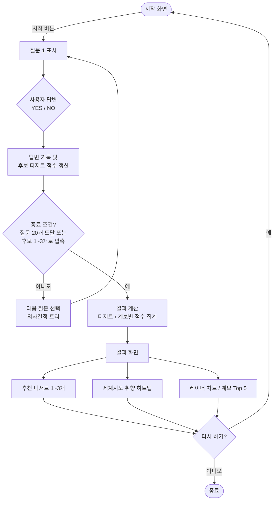
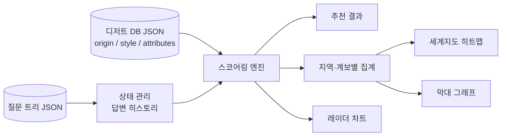

# 디저트 취향 스무고개 - PRD (Product Requirements Document)

## 1. 프로젝트 개요

**프로젝트명**: 디저트 취향 스무고개 (Dessert Preference 20 Questions Game)

**목표**: 사용자의 답변을 통해 개인의 디저트 취향을 분석하고 추천하는 대화형 게임 제공

**핵심 가치**: 
- 간단하고 직관적인 인터페이스
- 사용자 선호도 파악을 위한 효율적인 의사결정 구조
- 개인화된 디저트 추천

---

## 2. 핵심 기능

### 2.1 질문 시스템
- **의사결정 트리**: 사전 정의된 디저트 데이터베이스를 바탕으로 순차적 질문 진행
- **적응형 질문**: 이전 답변에 따라 가능한 디저트 범위를 좁혀나감
- **최대 질문 수**: 20개 (스무고개 규칙)

### 2.2 추천 엔진
- 누적된 답변을 통해 확률 기반으로 최적의 디저트 추천
- 최종 결과: 1-3개의 디저트 추천
- 신뢰도 점수 표시

### 2.3 사용자 경험
- 현재 질문 표시
- 진행 상황 표시 (예: 질문 5/20)
- 최종 결과 화면에서 선택된 디저트와 설명 제공
- 게임 재시작 기능

### 2.4 취향 시각화 (핵심 기능)
결과 화면에서 한눈에 취향을 파악할 수 있도록 3가지 시각화를 제공한다.

1. **세계지도 취향 히트맵 (Contour Map)**
   - 세계지도 위에 디저트 계보(국가/지역)별 취향 일치도를 색 농도로 표현
   - 계보 예: 프랑스(르 꼬르동 블루식 클래식 파티스리), 일본(와가시·말차), 이탈리아(젤라또·티라미수), 미국(브라우니·치즈케이크), 한국(떡·빙수), 중동(바클라바) 등
   - 국가 클릭/호버 시 해당 계보의 대표 디저트와 일치도(%) 툴팁 표시
   - 최고 일치 지역은 핀(마커)으로 강조
2. **취향 레이더 차트**: 단맛, 식감(부드러움/바삭함), 온도, 진하기, 과일/초콜릿/곡물 성향 등 5~6축
3. **계보 순위 막대 그래프**: 지역별 일치도 Top 5

**데이터 연결**: 각 디저트에 `origin`(국가 코드), `style`(계보) 속성을 추가하고, 답변마다 후보 디저트의 점수를 누적해 지역별 점수로 집계한다.

---

## 3. 기술 스택

| 계층 | 기술 | 설명 |
|------|------|------|
| **Frontend** | HTML5 | 구조 및 마크업 |
| | CSS3 | 스타일링 및 반응형 디자인 |
| | Vanilla JavaScript | 상호작용 로직 및 상태 관리 |
| **시각화** | 인라인 SVG | 세계지도(단순화된 국가 path 내장), 레이더/막대 차트 직접 렌더링 |
| | (선택) D3.js + TopoJSON | 정교한 지도가 필요할 때. 단, 오프라인 제약 시 로컬 번들 사용 |
| **데이터** | JSON | 디저트 데이터베이스(origin/style 포함) 및 질문 트리 저장 |
| **아키텍처** | 클라이언트 사이드 | 빌드 도구 불필요, 즉시 실행 가능 |
| **호환성** | 모던 브라우저 | Chrome, Firefox, Safari, Edge |

---

## 4. 데이터 구조

### 4.1 디저트 데이터베이스 (JSON)
```json
{
  "desserts": [
    {
      "id": "chocolate_cake",
      "name": "초콜릿 케이크",
      "description": "진한 초콜릿 맛이 특징인 부드러운 케이크",
      "origin": "FR",
      "style": "french_patisserie",
      "attributes": {
        "sweet": "high",
        "texture": "soft",
        "temperature": "room",
        "main_ingredient": "chocolate"
      }
    }
  ]
}
```

### 4.2 의사결정 트리
```json
{
  "questions": [
    {
      "id": "q1",
      "text": "차가운 디저트를 선호하나요?",
      "yes_next": "q2",
      "no_next": "q3"
    }
  ]
}
```

---

## 5. 아키텍처 고려사항

### 5.1 상태 관리 (MindAgent의 메모리 저장소 개념 적용)
- 사용자의 답변 히스토리 추적
- 현재 진행 중인 질문 인덱스 관리
- 추천 점수 계산 로직

### 5.2 액션 모듈 (MindAgent의 검증 개념 참고)
- 입력 값 검증 (YES/NO)
- 다음 질문 결정 로직
- 결과 계산 및 추천 로직

### 5.3 의사결정 로직
- **BFS (Breadth-First Search)**: 의사결정 트리 순회
- **스코어링**: 각 디저트별 매칭 점수 계산
- **정규화**: 확률 기반 추천 우선순위 결정

---

## 6. 포함할 디저트 (v1.0)

| 카테고리 | 디저트 | 특징 |
|---------|--------|------|
| 케이크 | 초콜릿 케이크, 치즈케이크, 당근 케이크 | 다양한 맛 프로필 |
| 차가운 디저트 | 아이스크림, 젤라또, 셔벗 | 온도 기반 구분 |
| 전통 과자 | 마카롱, 카라멜, 타르트 | 식감 다양성 |
| 기타 | 푸딩, 초콜릿 트러플, 마 | 특수 식감 |

**총 디저트 수**: 12-15개

---

## 7. UI/UX 디자인

### 7.1 화면 구성
1. **시작 화면**: 게임 설명 및 시작 버튼
2. **질문 화면**: 현재 질문, 진행도, YES/NO 버튼
3. **결과 화면**: 추천 디저트, 설명, 재시작 버튼

### 7.2 디자인 원칙
- 최소한의 인터페이스 (Minimalist)
- 명확한 CTA (Call-to-Action)
- 모바일 친화적 반응형 디자인
- 접근성 고려 (WCAG 기준)

### 7.3 서비스 흐름도



### 7.4 데이터 흐름



---

## 8. 마일스톤

### Phase 1: MVP (Week 1)
- ✅ 기본 HTML 구조 작성
- ✅ 디저트 데이터베이스 정의 (JSON)
- ✅ 의사결정 트리 구현
- ✅ 기본 CSS 스타일링
- ✅ JavaScript 상태 관리 로직 구현
- 세계지도 SVG + 지역별 취향 히트맵 (기본 버전)

### Phase 2: 기능 완성 (Week 2)
- 레이더 차트, 계보 순위 막대 그래프, 지도 툴팁/핀 인터랙션
- 결과 계산 로직 최적화
- 사용자 답변 히스토리 표시
- 반응형 디자인 테스트
- 브라우저 호환성 검증

### Phase 3: 개선 (Week 3+)
- 추가 디저트 데이터 확장
- 사용자 피드백 기반 질문 개선
- 저장 기능 (Local Storage)
- 공유 기능

---

## 9. 성공 지표 (KPIs)

### 9.1 기능 성공도
| 지표 | 목표 | 측정 방법 |
|------|------|---------|
| 추천 정확도 | 사용자 만족도 80% 이상 | 사용자 피드백 설문 |
| 게임 완료율 | 시작 사용자의 95% 이상 완료 | 분석 추적 |
| 평균 질문 수 | 20개 이하 | 로그 분석 |

### 9.2 기술 성공도
| 지표 | 목표 | 측정 방법 |
|------|------|---------|
| 로딩 시간 | < 1초 | 성능 프로파일링 |
| 크로스 브라우저 호환성 | 100% | 테스트 매트릭스 |
| 모바일 반응성 | 모든 기기에서 작동 | 반응형 테스트 |

### 9.3 시각화 성공도
- 결과 화면에서 사용자가 "내 취향 계보"를 5초 이내에 파악 (설문 기준 80% 이상)
- 지도 렌더링 < 500ms, 색약 사용자도 구분 가능한 팔레트 사용

### 9.4 사용자 경험
- 사용 중 오류 발생 빈도: 0건
- 평균 사용 시간: 3-5분
- 재사용 의향: 70% 이상

---

## 10. 평가 지표 (MindAgent의 CoS 개념 참고)

### 10.1 추천 효과도 (Recommendation Effectiveness Score)
```
RES = (정확한 추천 수 / 총 사용 횟수) × 100
```

### 10.2 사용자 만족도 (User Satisfaction Index)
```
USI = (긍정 피드백 / 총 피드백) × 100
```

### 10.3 게임 완성도 (Game Completion Rate)
```
GCR = (완료한 세션 / 시작한 세션) × 100
```

---

## 11. 제약 사항 및 가정

### 제약 사항
- 초기 버전은 클라이언트 사이드만 구현 (백엔드 X)
- 최대 20개 질문 제한 (스무고개 규칙)
- 오프라인 작동 (인터넷 미필요)

### 가정
- 사용자는 정직한 답변을 제공
- 사용자의 디저트 선호도는 속성 기반 분류 가능
- 의사결정 트리는 충분한 질문 수로 대부분의 케이스 커버

---

## 12. 향후 계획 (Phase 3+)

- 사용자 답변 저장 (Local Storage)
- 추천 결과 공유 기능 (소셜 미디어)
- 사용자 선호도 기반 통계 제공
- 디저트 레시피 연동
- 멀티 언어 지원

---

## 부록: 참고 자료

**MindAgent 구조 적용사항**:
- 의사결정 트리: MindAgent의 계획 및 도구 활용 개념
- 상태 관리: MindAgent의 메모리 저장소 패턴
- 검증 로직: MindAgent의 액션 모듈 개념

---

**작성일**: 2026-10-12  
**버전**: 1.0  
**상태**: Draft
